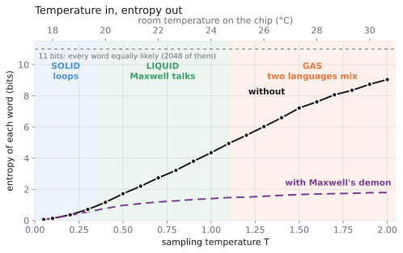
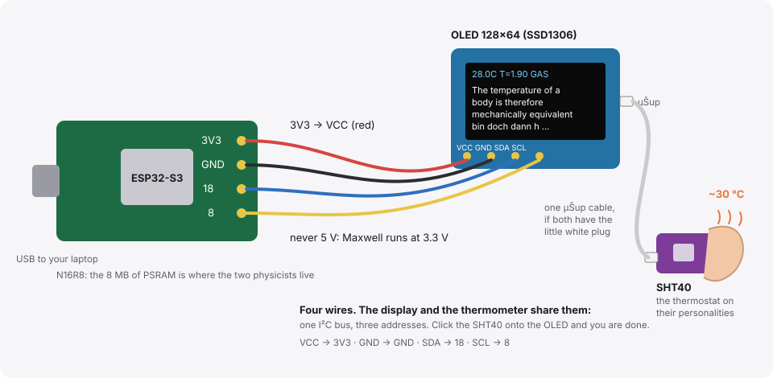

# Maxwell on a chip


In my PhD interview, someone asked me to write down the attention equation.

I started writing Boltzmann.

I wasn't wrong. Attention weights are a Boltzmann distribution: `exp(score) / sum(exp(score))`, with `sqrt(d)` sitting in
the place of the temperature. Same equation, different handwriting.

So I did the only reasonable thing. I trained a tiny language model on the two people who gave us that equation,
James Clerk Maxwell and Ludwig Boltzmann, put it on a chip, and let the room set its temperature.

Cold room: they get stuck. *"The temperature of a body is the same as that of the body, and that the temperature of
the body is the same as that of the body, and that..."* Warm the sensor in your hand: they start to ramble, and then
to speak each other's language. Somewhere in between, they almost make sense, which is more than can be said for
most of us at room temperature.

## What it is

- A 3M-parameter transformer trained from scratch on Maxwell's books (in English) and Boltzmann's lectures on gas
  theory (in his German original). One model, two physicists, two languages. No pretrained anything underneath:
  they know only what they wrote.
- It runs on an ESP32-S3 (1.6 MB in int4) and samples every word with `softmax(logits / T)`: the Maxwell–Boltzmann
  distribution, applied to Maxwell and Boltzmann.
- `T` comes from a real thermometer (an SHT40) next to the chip.
- The top line of the screen shows the reading, `T` and the phase the text is in (SOLID, LIQUID, GAS); after each
  paragraph, its entropy. Temperature in, entropy out.
- The BOOT button lets in **Maxwell's demon** (see below). He invented it; it seemed rude not to invite it.

## The physics, measured on this model

The same softmax in three rooms, after *"The temperature of a body is"*:


At 0.1, "the" gets 99.97% and nothing else gets a word in. At 1.9, nothing is sure of anything.



Turn the temperature up and the entropy of each word climbs from almost nothing to 9 bits, out of a possible 11.
The phase boundaries are where the text changes character, read off by eye: loops below, Maxwell in the middle, two
languages above.


### Maxwell's demon

In 1867 Maxwell imagined a small being at a door between two chambers of gas, letting only the fast molecules
through: order from disorder, without doing any work. Language models have one. It is called top-k sampling: only
the 4 most probable words get through the door.

Press BOOT and the demon is at the door (the screen says DEMON). The temperature doesn't change. The entropy does:
at T = 1.9, 8.7 bits per word without it, 1.8 with it (the dashed line above), and hot Maxwell goes from
*"...by equation Me When an plahoperbar expading electricity..."* back to
*"The temperature of a body is therefore, that it must be a line of internal motion."* Not true, but grammatical,
which is the most a demon can do.

It took physics about a century to work out why the demon doesn't break the second law (it has to forget what it
measured, and forgetting costs energy). Ours is powered over USB, so the books balance.

### Two gases

And the other thing Boltzmann is famous for: two gases mixing. Cold, Maxwell stays English. Hot, Boltzmann's German
leaks in, from 1% of his small words at T = 0.05 to 22% at T = 2. Warm Boltzmann returns the favour: *"...auf die Volumeneinheit abgeleitet werden kann. Direction of g; ..."*

## Build it



**Parts** (about the price of a nice lunch):

| part | why |
|---|---|
| ESP32-S3 dev board, N16R8 (16 MB flash, 8 MB PSRAM) | the two physicists live here; they need the PSRAM |
| 128x64 I2C OLED, 0.96" (SSD1306) | where they talk |
| SHT40 temperature sensor | the thermostat on their personalities |
| 4 dupont wires, or a μŠup (JST-SH 4-pin) cable if your OLED and SHT40 both have the little white connector | |
| USB cable | |

**Wiring.** The display and the thermometer share one I2C bus, so they go on the same four pins:

| OLED and SHT40 | ESP32-S3 |
|---|---|
| VCC | 3V3 |
| GND | GND |
| SDA | GPIO 18 |
| SCL | GPIO 8 |

If both modules have a μŠup connector (LaskaKit's do), click a μŠup cable from the SHT40 into the OLED and wire only
the OLED to the board. Never 5 V on these pins: Maxwell runs at 3.3 V.

**Flash.** Everything is in this repo, the model too:

```
arduino-cli core install esp32:esp32
arduino-cli lib install "Adafruit SSD1306" "Adafruit GFX Library"
./flash.sh                 # or ./flash.sh /dev/ttyUSB0
```

**Use.** Nothing. It starts writing. To change their mood:

- warm the SHT40 in your hand (it takes half a minute; thermometers are not in a hurry): they ramble, then switch languages;
- cool it below about 20 C (a cold window in November, or a cold glass next to it; keep it dry): they get stuck in loops;
- press the BOOT button: Maxwell's demon, on and off;
- type a line into the serial monitor (115200 baud) and they continue your sentence instead.

The temperature map: `T = 0.1 + 0.15 * (degrees C - 18)`, between 0.05 and 2. A 22 C room gives 0.7, a warm hand
around 30 C gives about 1.9. Change it in `firmware/maxwell/room_temp.h` if your flat runs hotter than mine.

**If it doesn't:**

- screen dark: SDA and SCL swapped, or the OLED is an SH1106 (set `OLED_CONTROLLER` in `firmware/maxwell/display.h`);
- the serial log says "no SHT40": the sensor isn't answering at 0x44 or 0x45, so they assume a polite 22 C forever. Check the cable;
- flashing fails: hold BOOT, press RESET, let go of BOOT, try again.

## The small print

- The texts are archive.org OCR, cleaned by `clean.py`: equations and tables are dropped (OCR turns them into confetti),
  so this Maxwell never writes a formula. He just talks about them.
- Boltzmann is one sixth of the text, so his paragraphs go in twice, to make the two gases more even. The mix in the
  output follows that choice: the model's distribution is only as fair as its data.
- Umlauts are written ae, oe, ue, ss. The chip is ASCII, like a typewriter from 1896.
- With about a million words, a model this size learns a fair amount by heart. Cold, it loops rather than recites.
- The mixing chart counts German among the small words (the, der, und...) in 48 paragraphs per point that start in
  English. The demon's line is the entropy it would leave at each step of the same paragraphs.
- Every paragraph on the chip is sampled fresh, word by word, at whatever the thermometer says right now. Nothing is
  recorded or replayed. At very low temperature the same start gives almost the same text, because that is what a
  cold distribution does.
- Not yet tried on a real thermometer. The firmware compiles, the C runtime matches PyTorch on this model, and the
  chip's own sampling code, run on a computer (`host/maxwell.c`), gives the entropies in the charts. The rest is physics.

## No chip?

The same model file, C runtime and sampling code, on a computer:

```
cc -O2 -o host/maxwell host/maxwell.c -lm
host/maxwell 18          # degrees Celsius
host/maxwell 30 demon
```

## Do it all yourself

```
./train.sh        # fetch the books, clean, tokenize, train (a GPU, a few minutes), export to model/
./flash.sh        # onto the chip
python sample.py runs/ple-mb-s0-best.pt --temps 0.1 0.7 1.9   # let them talk on your computer
python measure.py runs/ple-mb-s0-best.pt && python charts/draw.py   # the charts above
```

| folder | what |
|---|---|
| `model/` | the trained model (`model.bin`, int4) and its tokenizer |
| `firmware/maxwell/` | the sketch; `room_temp.h` is the thermometer part |
| `runtime/` | the transformer in C that runs on the chip; `boltzmann.h` is the whole idea in sixty lines |
| `host/` | the same code on a computer |
| `train/` | the trainer and the int4 exporter |
| `charts/` | the measurements and the pictures |

## Thanks

The runtime that runs a language model on this chip at all, and the trainer, come from
[esp32-ai](https://github.com/moudrkat/esp32-ai), my fork of Viacheslav Sierbov's
[slvDev/esp32-ai](https://github.com/slvDev/esp32-ai). Without his work, Maxwell would have nowhere to live.
See `THIRD_PARTY.md`.

MIT licence. The texts are in the public domain: Maxwell died in 1879, Boltzmann in 1906, and neither has complained.
