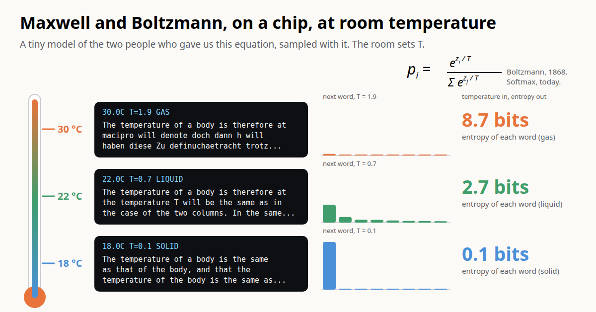
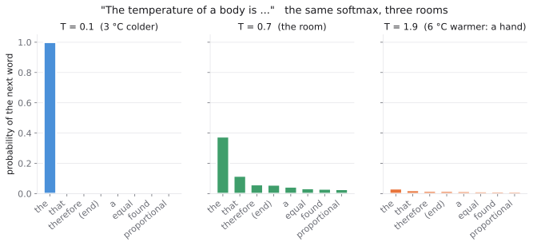
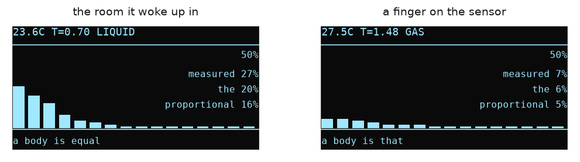
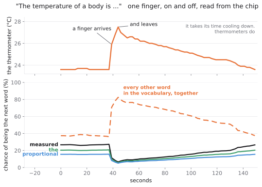
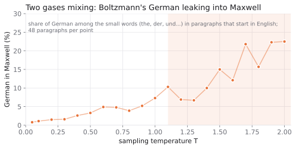

# Maxwell on a chip



In my PhD interview, someone asked me to write down the attention equation.

I started writing Boltzmann.

I wasn't wrong. Attention weights are a softmax, and a softmax is a Boltzmann distribution:
`exp(score) / sum(exp(score))`, with `sqrt(d)` sitting in the place of the temperature. Same equation, different
handwriting.

The same softmax sits at the other end of the model too, where it picks the next word. There the temperature is not
hidden in a square root: it is a number you can turn.

So I did the only reasonable thing. I trained a tiny language model on the two people who gave us that equation,
James Clerk Maxwell and Ludwig Boltzmann, put it on a chip, and let the room set its temperature.

Cold room: they go stiff, and now and then get stuck. *"It is evident that the phenomenon of the cause of the cause
of the cause of the cause of the cause..."* Warm the sensor in your hand: they start to ramble, and then
to speak each other's language. Somewhere in between, they almost make sense, which is more than can be said for
most of us at room temperature.

## What it is

- A 3M-parameter transformer trained from scratch on Maxwell's books (in English) and Boltzmann's lectures on gas
  theory, on mechanics and on Maxwell's own theory of electricity (in his German original). One model, two physicists, two languages. No pretrained anything underneath:
  they know only what they wrote.
- It runs on an ESP32-S3 (1.6 MB in int4) and samples every word with `softmax(logits / T)`: Maxwell–Boltzmann
  statistics, applied to Maxwell and Boltzmann.
- `T` comes from a real thermometer (an SHT40) next to the chip.
- The top line of the screen shows the reading, `T` and the phase the text is in (SOLID, LIQUID, GAS); under the
  text, the distribution each word was drawn from, as bars; after each paragraph, its entropy. Temperature in,
  entropy out.
- The BOOT button lets in **Maxwell's demon** (see below). He invented it; it seemed rude not to invite it.

## The physics, measured on this model

The same softmax in three rooms, after *"The temperature of a body is"*:



At 0.1, "measured" gets 76% and one other word most of the rest. At 1.9, the favourite has 3.5%: nothing is sure
of anything.

### The same chart, on the chip, by hand

Flash with `WORD="The temperature of a body is" ./flash.sh`, or type `?The temperature of a body is` into the serial
monitor, and they stop writing. The screen holds that one sentence and draws the distribution of its next word a few
times a second, at whatever the thermometer says right now: the 16 likeliest words as bars (the top of the plot is
50%), the three likeliest by name, and on the last line one word actually drawn from it.



Both screens are redrawn from the chip's own serial log, as is this:



At 23.6 C "measured" has 27%. One finger on the sensor, and within ten seconds it is 27.5 C and "measured" has 7%:
more than four fifths of the probability now sits on words that are not even in the top three. Then the sensor spends
two minutes cooling down, and Maxwell slowly makes up his mind again. Held longer, at 29.2 C, the three likeliest
words had 3% each.


Turn the temperature up and the entropy of each word climbs from almost nothing to 8 bits, out of a possible 11.
The phase boundaries are where the text changes character, read off by eye: stiff below, Maxwell in the middle, two
languages above.

Physicists have looked at this properly. Nakaishi, Nishikawa and Hukushima
([arXiv:2406.05335](https://arxiv.org/abs/2406.05335)) find a phase transition in the text a language model
generates as its temperature changes: repetitive structures below, incomprehensible text above, and at the critical
point, statistics like those of natural language. Mikhaylovskiy ([arXiv:2503.06330](https://arxiv.org/abs/2503.06330))
sorts generated text into solid, critical state and gas. They did it with real models and real statistics. This one
does it with a hand.



### Maxwell's demon

In 1867 Maxwell imagined a small being at a door between two chambers of gas, letting only the fast molecules
through: order from disorder, without doing any work. Language models have one. It is called top-k sampling: only
the 4 most probable words get through the door.

Press BOOT and the demon is at the door (the screen says DEMON). The temperature doesn't change. The entropy does:
at T = 1.9, 7.5 bits per word without it, 1.7 with it (the dashed line above), and hot Maxwell goes from
*"When a gas is compressed at temperature below small into equal jegk cobalausenden Strain..."* back to
*"When a gas is compressed in any manner, but in which case the gas becomes of greatest density. This is the great
number of molecules in the vessel, which in this case is a gas."* Grammatical, and in its last clause even true,
which is more than a demon is paid for.

It took physics about a century to work out why the demon doesn't break the second law (it has to forget what it
measured, and forgetting costs energy). Ours is powered over USB, so the books balance.

### Two gases

And the other thing Boltzmann is famous for: two gases mixing. In a paragraph that Maxwell starts, 5 to 7% of the
small words are German up to T = 1.3; then Boltzmann leaks in: 17% at 1.9, 29% at 2. *"...which are generally given merely
indum das erhaltene Krit dannsetzen als in der ins Decke' legte Algebra."* Warm Boltzmann returns the favour:
*"Die Molekuele bewegen sich freie Wein ... correspond with the law we mean when men supposes that..."*

### The other softmax

The interview question was about attention, and the thermometer is wired to the output. So what about the softmax
inside? Every row of the attention matrix is a Boltzmann distribution over the earlier words, and it has the same two
ways to fail: too hot and a word looks at everything equally, too cold and it stares at one word and ignores the rest.

Bruno, Chen, Lin, Polyanskiy and Rigollet ([arXiv:2605.08505](https://arxiv.org/abs/2605.08505)) ask exactly this,
for long contexts: how must the inverse temperature of attention grow with the number of words, so that attention
neither melts into "uniform averaging" nor "collapses onto the single closest key"? They find a critical scale in
between, where a handful of words keep the weight. Below it, they show, attention acts approximately like a heat
equation run backwards. Maxwell would have had opinions.

On this model, putting a temperature `tau` into the attention softmax (`attention.py`; 1 is what it was trained with)
moves the entropy of an attention row from 0.4 bits at tau = 1/8, through 2.8 at 1, to 4.8 at 8. The matrix freezes and
melts as it should. The text minds much less than it does at the output: hot attention loses the thread before it
loses the grammar. That is eight paragraphs per point, read by eye, so a first look and not a result.

## Build it


**Parts** (about the price of a nice lunch):

| part | why |
|---|---|
| ESP32-S3 dev board, N16R8 (16 MB flash, 8 MB PSRAM) | the two physicists live here; they need the PSRAM |
| 128x64 I2C OLED, 0.96" (SSD1306) | where they talk |
| SHT40 temperature sensor | the thermostat on their personalities |
| 4 dupont wires, or a μŠup (JST-SH 4-pin) cable if your OLED and SHT40 both have the little white connector | |
| USB cable | |

**Wiring.** The display and the thermometer share one I2C bus, so they go on the same four pins:

| OLED and SHT40 | ESP32-S3 |
|---|---|
| VCC | 3V3 |
| GND | GND |
| SDA | GPIO 18 |
| SCL | GPIO 8 |

If both modules have a μŠup connector (LaskaKit's do), click a μŠup cable from the SHT40 into the OLED and wire only
the OLED to the board. Never 5 V on these pins: Maxwell runs at 3.3 V.

No breadboard, and the display already sits on pins 18 and 8? Give the thermometer two pins of its own, any two free
ones, say 4 and 5 (SDA to 4, SCL to 5), and flash with `SHT=4,5 ./flash.sh`.

**Flash.** Everything is in this repo, the model too:

```
arduino-cli core install esp32:esp32
arduino-cli lib install "Adafruit SSD1306" "Adafruit GFX Library"
./flash.sh                 # or ./flash.sh /dev/ttyUSB0
```

**Use.** Nothing. It starts writing. To change their mood:

- warm the SHT40 in your hand (it takes half a minute; thermometers are not in a hurry): they ramble, then switch languages;
- cool it by three degrees (a window in November, or a cold glass next to it; keep it dry): they go stiff;
- press the BOOT button: Maxwell's demon, on and off;
- type a line into the serial monitor (115200 baud) and they continue your sentence instead;
- type a line that starts with a question mark, `?The temperature of a body is`, and they hold still on one word
  (see "One word, on the screen" above).

The thermometer calibrates itself: whatever room the chip wakes up in is "normal" (T = 0.7, liquid Maxwell), and
every degree warmer or colder moves T by 0.2, between 0.05 and 2. Three degrees colder and they freeze; a hand, six
degrees warmer, and they evaporate. So it works in a cold flat and in a heat wave, and you reset "normal" by
pressing RESET. Like the rest of us, they think the room they woke up in is how the world is.

**If it doesn't:**

- screen dark: SDA and SCL swapped, or the OLED is an SH1106 (set `OLED_CONTROLLER` in `firmware/maxwell/display.h`);
- the serial log says "no SHT40": the sensor isn't answering at 0x44 or 0x45, so they assume a polite 22 C forever and never change. Check the cable, and push the little white plug all the way in: a sensor with its data wires connected but no power still answers its address, and then never finishes a measurement;
- flashing fails: hold BOOT, press RESET, let go of BOOT, try again.

## The small print

- What is physics here and what is not. The mathematics is exact: `softmax(z / T)` is the Boltzmann distribution of a
  system whose states are the 2048 tokens, with energies `-z`, and its entropy grows with `T` as it must. The
  thermometer is theatre. `T` is a pure number, and the chip moves it by 0.2 per degree. Done honestly, in
  proportion to the absolute temperature, a warm hand would change `T` by 3% and you would see nothing: freezing
  them would take about -231 C, and evaporating them about 530 C. The phases are a way of speaking; a real phase
  transition needs an infinite text. The demon is a joke with a real formula in it.

- The texts are archive.org OCR, cleaned by `clean.py`: equations and tables are dropped (OCR turns them into confetti),
  so this Maxwell never writes a formula. He just talks about them.
- Boltzmann is a bit over a quarter of the paragraphs, Maxwell the rest. The mix in the output follows that: the
  model's distribution is only as fair as its data.
- Umlauts are written ae, oe, ue, ss. The chip is ASCII, like a typewriter from 1896.
- With about a million words, a model this size would rather learn them by heart. Dropout (0.3, in training only)
  talks it out of that: on text it never saw, the loss went from 3.26 to 2.97 against the first version, which had no
  dropout, less Boltzmann, and looped whenever it was cold.
- The mixing chart counts German among the small words (the, der, und...) in 48 paragraphs per point that start in
  English. The demon's line is the entropy it would leave at each step of the same paragraphs.
- Every paragraph on the chip is sampled fresh, word by word, at whatever the thermometer says right now. Nothing is
  recorded or replayed. At very low temperature the same start gives almost the same text, because that is what a
  cold distribution does.
- Tried on a real board on 16 November 2026: an ESP32-S3 N16R8, an SSD1306 and an SHT40 on two pins of its own. It
  writes about 4.6 tokens a second with the bars on. At T = 0.70 the chip gives the three likeliest words 27, 20 and
  16%, where PyTorch gives 25, 21 and 16% (4-bit weights against 32-bit). It has only been warmed, by a finger: nobody
  has cooled it yet, so SOLID has been seen on a computer and not on the chip. The entropy and mixing charts are
  still the computer's (`host/maxwell.c`, `measure.py`).

## No chip?

The same model file, C runtime and sampling code, on a computer:

```
cc -O2 -o host/maxwell host/maxwell.c -lm
host/maxwell 19          # degrees Celsius, for a chip that woke up at 22
host/maxwell 28 demon
```

## Put your own dead physicist on a chip

The books are a list: `books.txt`, archive.org identifiers, one per line. Swap them for anyone in the public domain
(Darwin, Newton, Lovelace, your favourite alchemist) and run `./train.sh`, then `./flash.sh`. The sentences each
paragraph starts with are in `runtime/boltzmann.h` (`ROOM_STARTS`); give your physicist a few of their own.
If they turn out funnier than Maxwell, open a PR. I can take it.

## Do it all yourself

```
./train.sh        # fetch the books, clean, tokenize, train (a GPU, a few minutes), export to model/
./flash.sh        # onto the chip
python sample.py runs/ple-mb-s0-best.pt --temps 0.1 0.7 1.9   # let them talk on your computer
python measure.py runs/ple-mb-s0-best.pt && python charts/draw.py   # the charts above
```

| folder | what |
|---|---|
| `model/` | the trained model (`model.bin`, int4) and its tokenizer |
| `firmware/maxwell/` | the sketch; `room_temp.h` is the thermometer part |
| `runtime/` | the transformer in C that runs on the chip; `boltzmann.h` is the whole idea in sixty lines |
| `host/` | the same code on a computer |
| `train/` | the trainer and the int4 exporter |
| `charts/` | the measurements and the pictures |

## Want to help?

See `CONTRIBUTING.md`: the short list of what is untested, and what I'd love to see. Nobody has frozen them on real hardware yet.

## Thanks

The runtime that runs a language model on this chip at all, and the trainer, come from
[esp32-ai](https://github.com/moudrkat/esp32-ai), my fork of Viacheslav Sierbov's
[slvDev/esp32-ai](https://github.com/slvDev/esp32-ai). Without his work, Maxwell would have nowhere to live.
See `THIRD_PARTY.md`.

MIT licence. The texts are in the public domain: Maxwell died in 1879, Boltzmann in 1906, and neither has complained.
